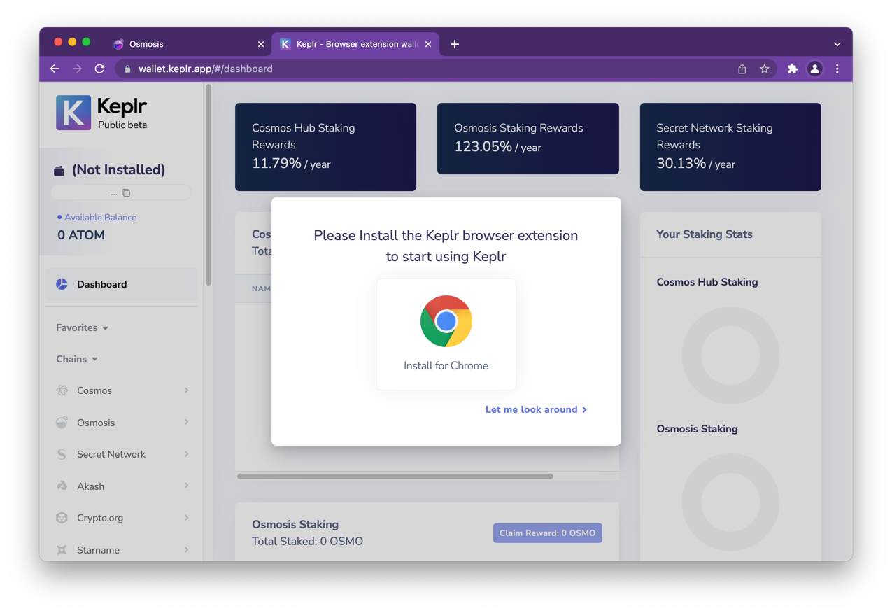
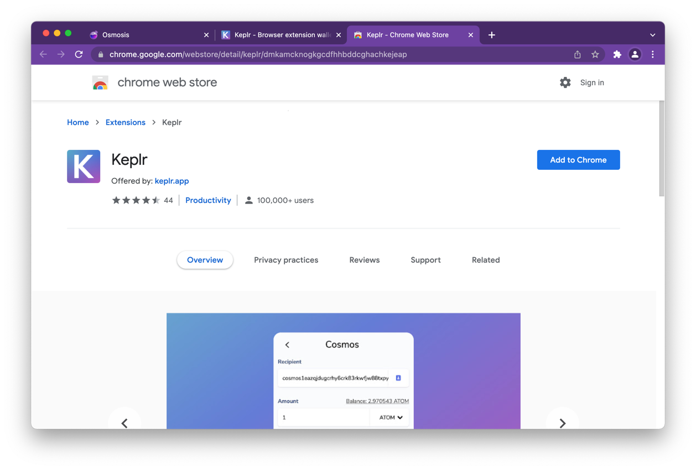
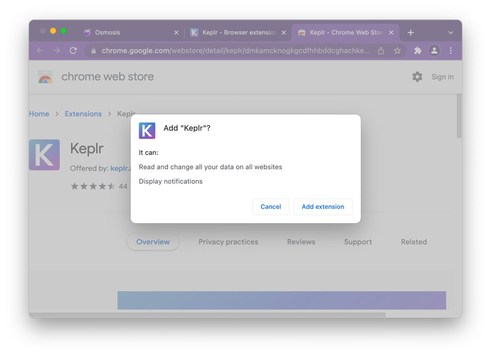
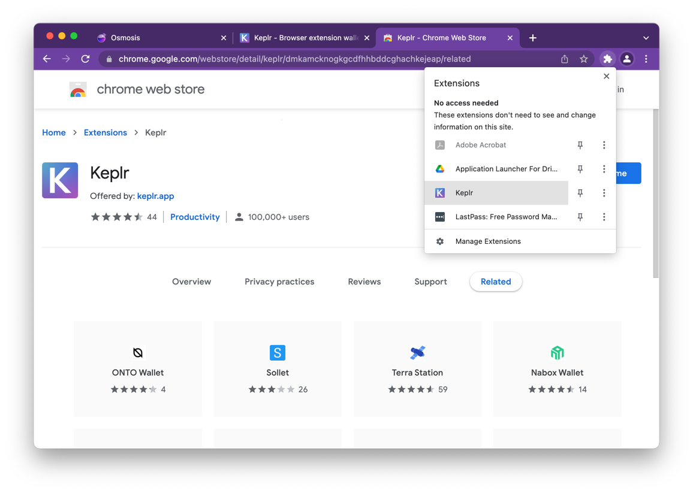

import { Callout } from '#vocs-compat';

[Keplr](https://www.keplr.app/) is the recommended browser extension for CosmWasm / Cosmos chains, including Terp Network.

## 1. Install

1. Open [https://www.keplr.app/](https://www.keplr.app/) and install the extension for your browser (Chrome / Brave / Edge supported).
2. Confirm the extension pin in the browser toolbar.

## 2. Create or import an account

On first open, Keplr offers:

| Option | When to use |
|--------|-------------|
| **Create new account** | New seed (12/24 words) |
| **Import existing account** | Restore from mnemonic or private key |
| **Import Ledger** | Hardware key (see [Ledger](/docs/guides/authentication/wallets/ledger)) |
| **Social / one-click** | Convenience only — understand recovery model before funding |

<Callout type="error" title="Seed phrase safety">
No team will ever ask you for your mnemonic. Anyone who does is a scammer. Write the phrase offline and store it offline.
</Callout>

### Create with a new mnemonic

1. Choose **Create new account**.
2. Record the 12- or 24-word phrase in a secure offline place.
3. Set a local wallet name + unlock password.
4. Confirm the phrase order → **Register**.

### Import existing mnemonic or private key

1. **Import existing account**.
2. Choose mnemonic (12/24) or private key; enter carefully (lowercase, correct order).
3. Set name + password → **Next**.

## 3. Add Terp Network

Keplr may pick up Terp from the chain registry. If not:

1. Open Keplr → chain list → **Add chain** / manage chains.
2. Select **Terp Network** when listed, or add manually:

| Field | Mainnet |
|-------|---------|
| Chain ID | `morocco-1` |
| RPC | `https://rpc.cosmos.directory/terpnetwork` (or your node) |
| REST | `https://rest.cosmos.directory/terpnetwork` |
| Bech32 prefix | `terp` |
| Coin denom | `uthiol` / display THIOL |

3. Approve connection when a dApp or this docs site prompts.

Testnet: chain ID `90u-4` (confirm endpoints from [public resources](/docs/resources/public)).

## 4. Fund and try a transfer

- **Testnet faucet:** see [Quick start](/docs/overview/quickstart)
- Send a small transfer to yourself to confirm RPC + fees

## Next

- [Key safety](/docs/guides/authentication/wallets/safety)
- [Ledger](/docs/guides/authentication/wallets/ledger)
- [Authenticators](/docs/guides/authentication/authenticators) for programmable auth
- [Libraries](/docs/resources/libraries) for CosmJS / app integration
