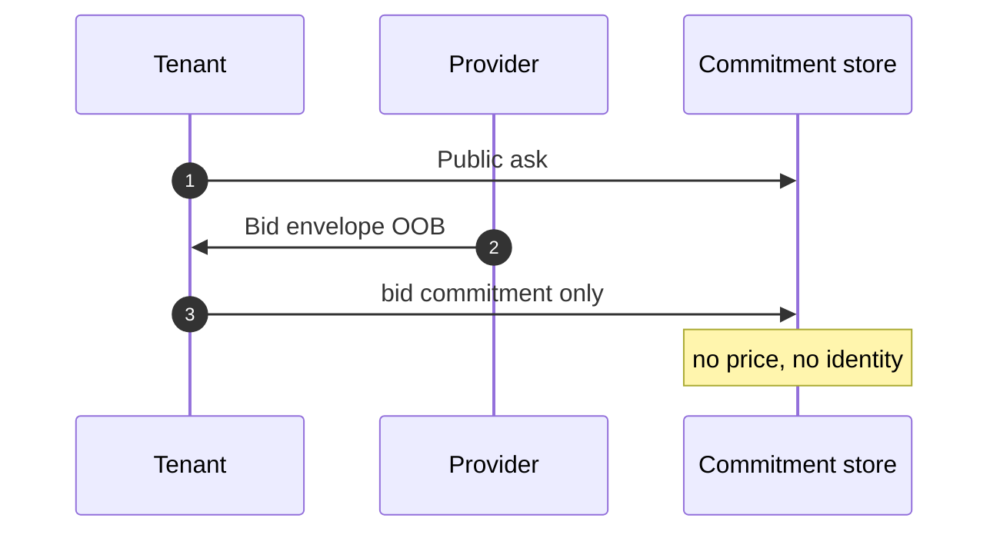
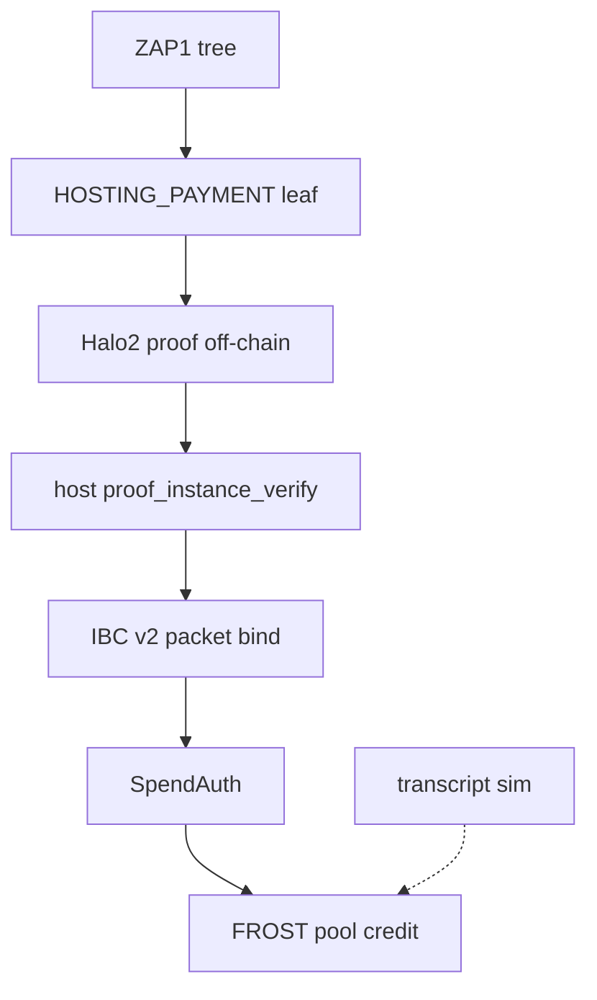
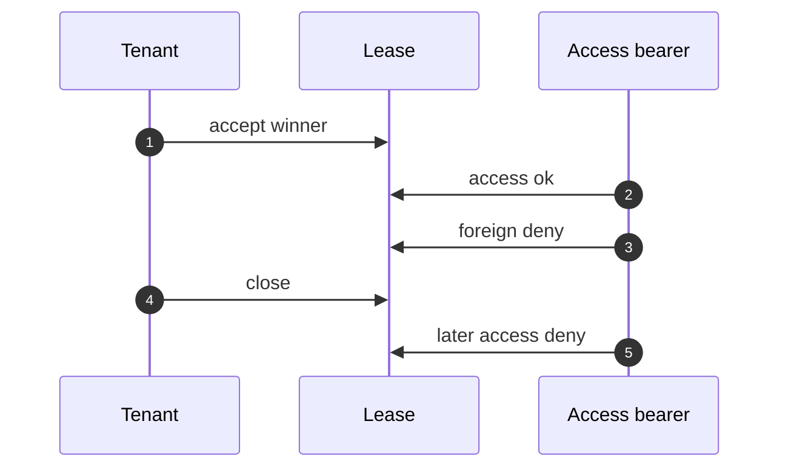
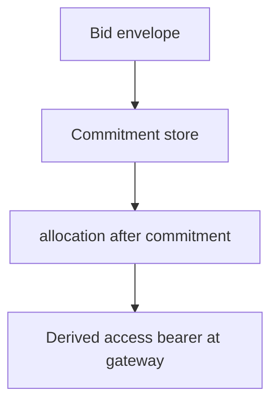

# For engineers

This page names **what the library already implements**. State first, then the type. Crosslink 08-wasm is a **different client**. Pay inclusion is ZAP1 plus IBC v2 packet bind, verified on-chain with Halo2.

re-zerve lives in the `private-inference-rent` crate. You run the same store / attest / credit / spend sequence locally that you expect on a public network. There is no public re-zerve network.

## Lab vs public network

| What | Where it lives |
|---|---|
| Public ask, sealed bid, commitment-only record | Implemented in the crate; available in the local lab |
| `cw-pir-commit` CosmWasm commitments | Implemented in the crate; local e2e stores it on a spawned Terp chain |
| `credit_deposit_zap1` + `SpendAuth` | Implemented in the crate |
| Local transcript credit | Sim path only (`credit_transcript` / `prove_for_test`) |
| `cw-zap1-ibcv2` Halo2 `AttestHalo2` | Implemented; local e2e stores the contract and a Pasta circuit, then host-verifies |
| `cw-ics08-wasm-zap1` | Implemented in the crate; not the selected public IBC client |
| `DerivedAccess` + `LeaseBook` | Implemented in the crate |
| `akash-provider-pir` gateway + bid gate | Implemented in the fork; public ict path still runs the **stock** provider image |
| Ironwood shielded notes on Zakura | Implemented in the local lab (not Sapling, not Orchard) |
| Secret CMP / Stoffel as product ingest | Not product |
| Opening an Orchard memo | Not this crate |

Do not treat a missing chain or missing host verifier as success. Live-ict fails closed.

## Market shape

The tenant posts a **public** ask. The provider sends an **encrypted bid envelope off-chain**. The chain (or `cw-pir-commit`) records **commitments only** — no price, no identity, no ciphertext.

**Shipped**

- `PublicAsk` / `ResourceAsk` — SDL + resources. `ask_commitment()` is domain-separated and includes `tenant_label`.
- `PlaintextBid` stays off chain.
- `EncryptedBidEnvelope::seal` — ChaCha20-Poly1305; nonce generated in `seal`; AAD over `ask_id` + nonce. Tamper is an auth fail.
- `BidCommitment` — what the public record may hold.
- `OnChainView` / `CommitmentModule` — `post_commitment` stores ask and bid commitments. The chain payload must not contain price or identity.

## Pay inclusion

Product credit binds a ZAP1 **HOSTING_PAYMENT** leaf. Off-chain prove; on-chain **Halo2** `proof_instance_verify(zkid, proof, instances)` with a pinned verifying key (Pasta, k=17, four public instances). Merkle siblings are **not** in the CosmWasm execute. A missing host fails closed.

**Product ingest**

1. `Zap1Ibcv2Bundle` — group, note, amount, event kind (`HostingPayment` | `ProgramEntry` | `OwnershipAttest`), leaf, root, optional tip reference (hex recorded, **not opened**), IBC v2 packet fields.
2. `zap1-verify` 0.2.1 — BLAKE2b leaf and node hashes. Used to **build** the witness; the chain does not re-walk siblings on execute.
3. `IbcV2PacketAttest` — source/dest client, sequence ≠ 0, `app_data_hash` over note, amount, FROST group, and leaf.
4. Packet commitment is a **local** tagged hash. It is **not** a light client.
5. `SpendAuth::from_quorum` — group, note, amount, optional bid commitment, layered quorum. A quorum of labels that does not bind note/amount is rejected.
6. `FrostThresholdPool::credit_deposit_zap1`. If the pool is bound to FROST, the signature must verify over the spend message.
7. FROST **DKG** among tenant, provider, and resolver (`frost-ed25519` part1/part2/part3). Dealer-generated packages are not product custody.

**Sim only**

- `DepositAttestation::prove_for_test` and transcript credit. Not Ironwood inclusion. Not a Zcash state root.

**Not pay inclusion**

- Crosslink headers / Crosslink 08-wasm.
- Full ICS-08 nine-entrypoint host as the live Terp client.
- Opening a shielded memo.

## Escrow and notes

`cw-pir-escrow` records open, accrue, close, and a **grant**. It must not move value with `BankMsg`. Accrued amount comes from work receipts, not a closer-supplied integer.

Shielded value is **Ironwood** pool notes on Zakura (NU6.3 v6). Spends are two intents: earned to the provider, remainder to the tenant, signed by the DKG threshold.

## Lease access

After accept, only the **winner** derived access bearer opens the lease. A foreign bearer and any call after close are denied.

**Shipped**

- `DerivedAccess::from_session(ask_id, session_key, bid_commitment)` — 32-byte secret + `bearer_hex()`.
- `LeaseBook::accept_bid` / `access` / `close`.
- Local settlement: `WorkReceipt` + `SettlementBook` (not an Akash lease object).

This is the private-path analogue of an Akash JWT. It is **not** ES256K tenant JWT.

## Provider gate

The provider takes an encrypted bid, allocates **only after** the commitment is recorded, and checks a **derived** access bearer at the gateway.

**Fork (`akash-provider-pir`), available in the local lab**

- Gateway `AcceptBearer` matches `DerivedAccess`.
- `AuthProcess` tries the hex bearer **before** public JWT.
- Bid engine: allocate only after commitment.

**Public network today:** the stock Akash provider image. The fork is not the live process until that image is swapped.

## Contracts you should call (not reimplement)

| Concern | Names |
|---|---|
| Ask | `PublicAsk`, `ask_commitment` |
| Bid | `EncryptedBidEnvelope`, `BidCommitment` |
| Public record | `OnChainView::chain_payload`, `CommitmentModule`, `cw-pir-commit` |
| Auth | `SpendAuth`, `SpendAuth::from_quorum`, `LayeredQuorum` |
| Pool | `FrostThresholdPool::credit_deposit_zap1` |
| Inclusion | `Zap1Ibcv2Bundle`, `AttestHalo2`, `IbcV2PacketAttest` |
| Access | `DerivedAccess`, `LeaseBook` |
| Settlement | `WorkReceipt`, `SettlementBook`, `cw-pir-escrow` grant |
| Notes | Ironwood outputs on Zakura |
| Sources | [Libraries and papers](/research/re-zerve/sources) |
