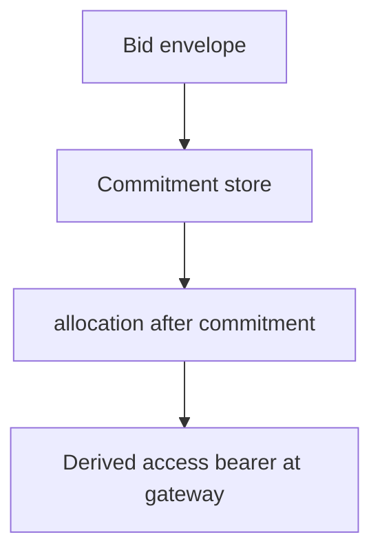

# For providers

You run capacity the way an Akash provider does. This market is not a public price board. You see the **public** ask. You send the **encrypted** bid off-chain. You allocate only after the **commitment** is recorded. You open the lease only for the **derived access bearer**.

The re-zerve provider hooks are a **lab fork**, not the stock provider image on the public network.

## What you can see

The tenant posts a **public** ask: SDL, resources, a domain-separated ask commitment that includes the tenant label. Anyone, including you, can read that surface.

You do **not** see competing prices or bidder identities on the commitment store. That store holds commitments only.

## What you send

You seal a bid envelope off-chain (ChaCha20-Poly1305, AAD over the ask id and nonce). You deliver that envelope to the tenant out of band.

The public record after you bid is a **bid commitment**, not the envelope. Price and identity stay off the chain-shaped view.

## Commitment before allocate

Do not spin the lease until the bid commitment is posted.

When the private gate is on, allocation is refused unless a recorded commitment is present. The public Akash default still bids without that gate. Private re-zerve path: **committed**, then **allocated**.

## Derived bearer at the gateway

After accept, the winner’s access is a **derived access bearer**: hex of a tagged hash over the out-of-band session secret, the bid commitment, and the ask id. It is not an ES256K Akash JWT.

The gateway accepts that bearer as full lease access for the winner. A foreign bearer is denied. After close, the same bearer is denied.

Stock JWT and mTLS can still exist on the cluster path. They are a different credential. Do not treat a tenant JWT as the re-zerve lease key.

## Provider gate

The provider takes an encrypted bid, allocates only after the commitment is recorded, and checks a derived access bearer at the gateway.

## What you must not log

| Keep out of logs | Why |
|---|---|
| Session key | It derives the bearer |
| Plaintext bid (price, terms) | The envelope is private |
| Bearer secret or raw bearer | Gateway credential for the winner |
| Tenant identity from the opened envelope | Not a public field |
| Nonce reused with the same key | Breaks the seal |

Log ask id, commitment hex, allocate/deny, and gateway accept/deny. Do not log the envelope plaintext or the derivation inputs.

## Public vs private

| Public | Private |
|---|---|
| Ask (SDL, resources) | Bid price and bidder identity |
| Ask commitment, bid commitment | Bid envelope, session key |
| Lease open / closed | Derived access bearer |

## Lab vs network

| Implemented in the crate / lab fork | Not on the public network yet |
|---|---|
| Encrypted bid envelope and commitment-only record | A network of providers bidding in the wild |
| Allocate only after a posted commitment (gate on) | Stock provider image running this gate |
| Derived bearer check at the gateway | Production `provider-services` from the fork as the live process |

This is not a production marketplace until network bids and the live pay client are the default path.
