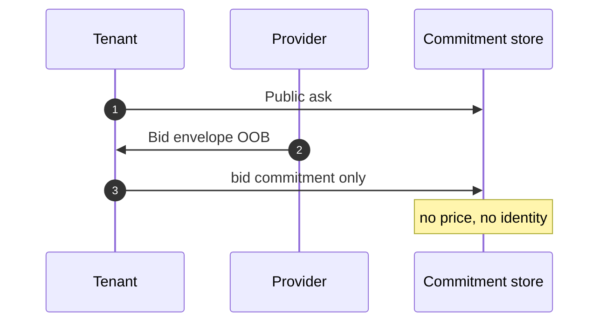
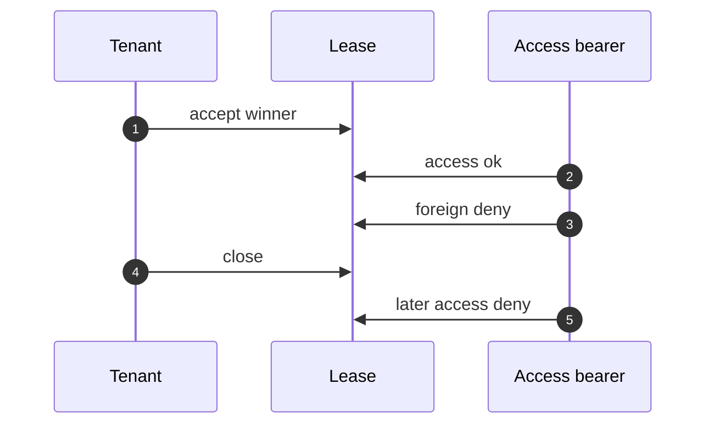

# For tenants

You want private inference capacity. You post what you need in public. You never put price or bidder identity on chain. You open the leased endpoint only with the winner’s derived access bearer.

re-zerve is available in the **local lab**. Network bids as the default path are not on the public network yet.

## Public ask

The ask is the only plaintext market surface. You post an ask id, a tenant label, a manifest, compute resources (CPU, memory, storage, GPU), and an inference profile. Empty asks never open. Zero CPU or memory never open.

The public record binds a commitment over that ask. Changing only the tenant label changes the commitment. Anyone can see the ask and that binding. Nobody sees a bid price on this surface.

## What stays off-chain

The provider sends you an encrypted bid envelope out of band. The envelope is sealed with the session key (**ChaCha20-Poly1305**). The plaintext bid holds ask id, bidder identity, price, and provider endpoint. That payload is never serialized on-chain.

You record a **bid commitment** only: a hash over the sealed envelope. The commitment store holds no price and no identity.

The tenant posts a public ask, the provider sends an encrypted bid envelope off-chain, and the chain only records commitments.

## How payment is authorized

Product credit proves a **HOSTING_PAYMENT** leaf is in the ZAP1 tree without putting the payment path on the public execute. The chain sees a Halo2 proof and 128 bytes of public instances (tree root, FROST group, amount class, payment kind). Merkle siblings stay in the witness.

That bind plus **SpendAuth** credits a FROST-owned pool. SpendAuth binds group, note, amount, and an optional bid commitment, then a real outer quorum.

A local transcript credit is only the **sim** path. It is available in the local lab. It is not the public-network ingest. The product ingest does not treat a local hash as a Zcash state root and does not open a memo.

## How you open the lease

You accept the winning bid. Access is a 32-byte secret derived from the same session key that sealed the bid, plus the bid commitment and ask id. The HTTP bearer is hex of a second domain-separated hash of that secret. It is not an Akash ES256K tenant JWT and not an mTLS cert.

A foreign bearer is denied. After you close the lease, even the winner bearer is denied.

After accept, only the winner derived access bearer opens the lease; a foreign bearer and any call after close are denied.

## What others cannot see

| Public / committed | Private / off-chain |
|---|---|
| Ask id, tenant label, manifest, resources, inference profile | Bid price |
| Ask commitment | Bidder identity |
| Bid commitment (hash of the sealed envelope) | Provider endpoint in the plaintext bid |
| Lease open / closed, winner bearer check at the gateway | Session key and 32-byte access secret |

Others can see that you asked and that a commitment exists. They cannot see who bid, what they charged, or the bearer that opens the endpoint.
