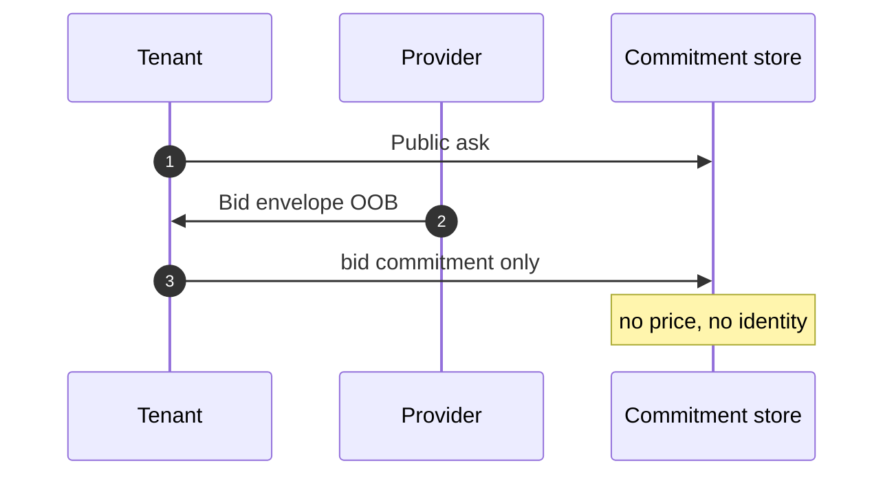
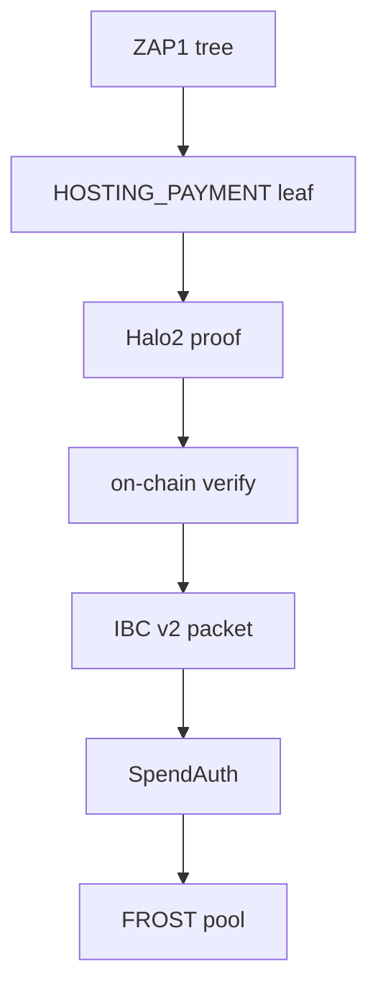
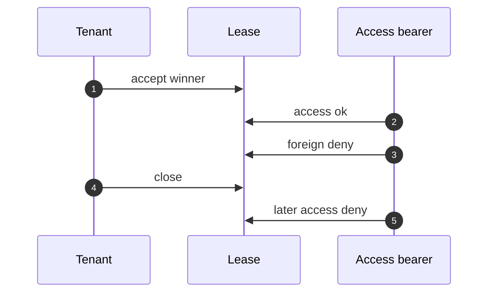

# How it works

Four steps. Each keeps a different secret off the public record.

## 1. Ask and bid

The tenant posts a **public ask** (manifest and resources). The provider seals a **bid envelope** with ChaCha20-Poly1305 and delivers it out of band. The chain stores **commitments only**.

See [For tenants](/research/re-zerve/for-tenants) and [For providers](/research/re-zerve/for-providers).

## 2. Pay inclusion

A **HOSTING_PAYMENT** leaf is in the ZAP1 BLAKE2b tree. The prover keeps serial, month, year, and Merkle siblings in the witness. The chain verifies a **Halo2** proof against a pinned verifying key. Public instances are 128 bytes: merkle root, FROST group, amount class, payment kind.

An IBC v2 packet binds note, amount, group, and leaf. **SpendAuth** from a layered quorum credits the FROST pool.

Crosslink headers are a different client. They are not this pay path.

## 3. Custody and close

Three parties run **FROST DKG**: tenant, provider, resolver. Happy-path sign is tenant + provider. The resolver signs only after a recorded **close grant**.

Value is **Ironwood** shielded notes on Zakura. Close is two spends: earned to the provider, remainder to the tenant. The CosmWasm escrow module records the grant. It does not pay in bank coins.

Accrued amount comes from **work receipts** between open and close heights. The closer does not set earned.

## 4. Lease access

Accept the winning bid. Only the **derived access bearer** (from the out-of-band session key) opens the endpoint. A foreign bearer is denied. After close, the winner is denied too.

## What this is not

| Not this | This instead |
|---|---|
| Public price board | Encrypted bid, commitment on chain |
| Bank coins as product money | Ironwood notes + FROST spend |
| Crosslink as pay inclusion | ZAP1 + Halo2 + IBC v2 packet |
| Dealer FROST as product custody | Three-party DKG |
| Akash tenant JWT as the lease key | Derived access bearer |
| A public marketplace | Local lab that runs the mainnet sequence |
