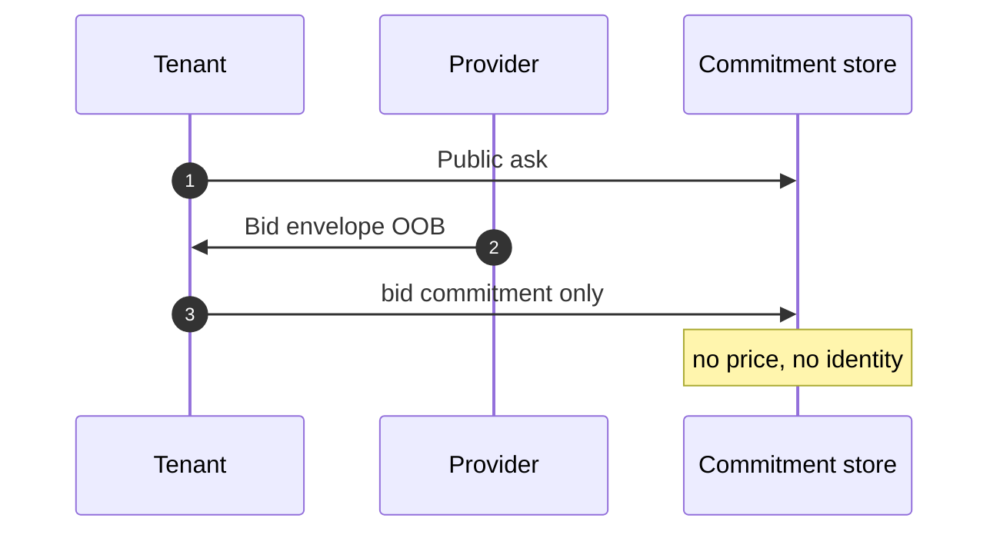

# re-zerve

**re-zerve** is a capacity market with a public ask and a private bid. The chain-shaped record holds **commitments only**. Price, bidder identity, and the access secret stay off that surface.

You run this as a **research product in the local lab**. It is not a public marketplace. The public Terp chain is a different product.

## Who this is for

### [For tenants](/research/re-zerve/for-tenants)

Post a public ask, keep price and identity off-chain, authorize payment, open the lease with a derived bearer.

### [For providers](/research/re-zerve/for-providers)

Public asks, encrypted bids, commit before allocate, derived bearer at the gateway.

### [For engineers](/research/re-zerve/for-engineers)

Shipped types and contracts. Lab crate vs public network. Crosslink is not pay inclusion.

## Market shape

The tenant posts a public ask, the provider sends an encrypted bid envelope off-chain, and the chain only records commitments.

## What is public vs private

| Public / committed | Private / off-chain |
|---|---|
| Ask (manifest, resources, inference profile) | Bid price |
| Ask commitment | Bidder identity |
| Bid commitment (hash of the sealed envelope) | Provider endpoint in the plaintext bid |
| Lease open / closed | Session key and access bearer |

## Pay and settle

Product credit proves a **HOSTING_PAYMENT** event is in the ZAP1 tree. On-chain execute carries a Halo2 proof and public instances only — not the Merkle siblings. Value lives in **Ironwood** shielded notes whose spend authority is a **FROST** group (tenant + provider; resolver only after a recorded close grant). CosmWasm escrow emits **grant and events**, not bank coins.

Local transcript credit is the **sim** path. It is not Zcash.

See [How it works](/research/re-zerve/how-it-works), [Lab vs network](/research/re-zerve/status), and [Sources](/research/re-zerve/sources).
